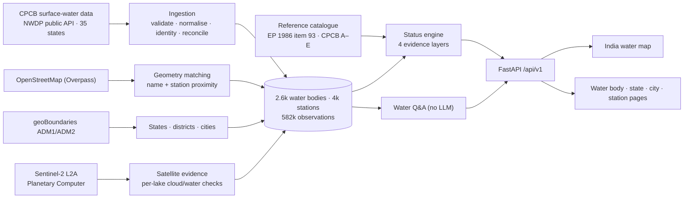
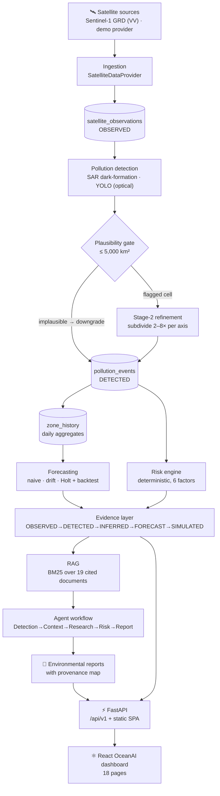
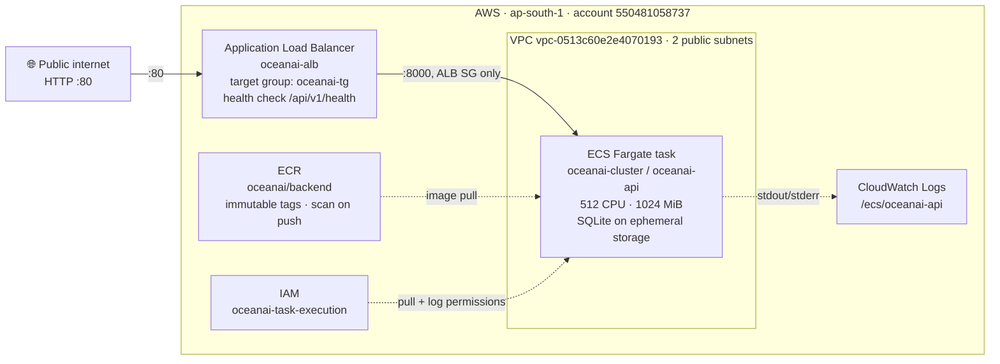

# OceanAI — India Water Intelligence

**What is actually known about India's rivers, lakes, ponds and coastal waters — when it was measured, what it showed, against which standard, and where every number came from.**

[](https://www.python.org/)
[](https://react.dev/)
[](https://fastapi.tiangolo.com/)
[](#testing)
[](docs/data-sources.md)
[](LICENSE)

> **Live demo status.** The public deployment below still runs **v1, the marine
> pollution platform**. The India Water Intelligence version on this branch has
> been built and verified locally (tests, browser, Docker) but **has not been
> deployed**. See [Deployment](#deployment).

## 🌊 Live Demo (v1)

### ▶ **[Open the OceanAI dashboard](http://oceanai-alb-746074560.ap-south-1.elb.amazonaws.com/app)**

| | |
|---|---|
| 🖥️ **Dashboard** | http://oceanai-alb-746074560.ap-south-1.elb.amazonaws.com/app |
| ⚡ **API** | http://oceanai-alb-746074560.ap-south-1.elb.amazonaws.com/api/v1 |
| 📘 **OpenAPI docs** | http://oceanai-alb-746074560.ap-south-1.elb.amazonaws.com/docs |
| ❤️ **Health** | http://oceanai-alb-746074560.ap-south-1.elb.amazonaws.com/api/v1/health |

Running on AWS ECS Fargate behind an Application Load Balancer in `ap-south-1`.

> ⚠️ **HTTP, not HTTPS.** No TLS certificate is attached, because that requires a
> domain the author owns — so your browser will show "Not secure" and traffic is
> unencrypted. The endpoint is unauthenticated and carries only synthetic
> demonstration data; send nothing sensitive to it.
>
> ⚠️ **Demo mode is on.** Every figure shown is `SIMULATED` and labelled as such
> in the UI and the API. Read [Limitations](#limitations-read-this) before drawing
> any conclusion from what the dashboard displays.

---


---

# Part 1 — India Water Intelligence

## The problem

India's water-quality data exists, but it is scattered across monitoring
portals, spreadsheets and reports, keyed by station labels rather than by
water body, and often years old without saying so. A dashboard that shows
"Mithi River: polluted" is making a claim about today that its data may not
support.

## What this does

It resolves CPCB monitoring records into **water bodies** across all of
India, places them on a map with their **real shapes** where one can be
matched, compares them only against a **standard that is shown to apply**,
and keeps apart what was measured, what a standard says, what an official
body classified, and what the platform derives.



### The honest centre of the product

Most state extracts on the portal end in 2020–2021 (a few Meghalaya stations
run to 2025). So every water body shows two things, never merged:

| | Mithi River, Mumbai |
|---|---|
| **Current data availability** | Latest available observation 02 Dec 2021 — *current condition cannot be established from this dataset* |
| **Latest measured status** | *High concern* **as of 02 Dec 2021**, compared against the EP 1986 bathing-water criteria (faecal coliform 4.4× the limit) |

## Real data

- **CPCB Surface Water Quality (Manual)** via the National Water Data Portal:
  all 35 state/UT codes, 211 resources, **582,192 observations, 4,000
  stations, ~2,600 water bodies**, zero ingestion errors.
  Live counts: [DATASET_COVERAGE.md](docs/DATASET_COVERAGE.md).
- **OpenStreetMap** geometry for rivers and lakes, accepted only where CPCB
  stations lie on or near it, with OSM ids, licence and retrieval time.
- **geoBoundaries** state and district boundaries; **35 cities** defined as
  documented groupings of whole districts.
- **Sentinel-2 L2A** scenes for matched lakes, kept only when the lake itself
  is clear of cloud. [Sources and what was not usable](docs/data-sources.md).

## Status, not a score

No 0–100 score, and **no default standard**. Rivers are compared against the
EP Rules 1986 bathing-water criteria because that is what CPCB uses to
identify polluted river stretches; other water bodies are compared only when
a designated use is recorded or chosen, otherwise the page says *"Reference
comparison unavailable"*. *Polluted stretch* appears only when an official
CPCB classification is imported (none is loaded — the report is PDF-only).
Answers and pages separate **MEASURED · REFERENCE_COMPARISON ·
SOURCE_CLASSIFICATION · DERIVED_STATUS**, and satellite values are labelled
*uncalibrated proxy*, never measurements.
[Engine and standards](docs/water-status-engine.md).

## The map

`/app/map`: rivers as lines and lakes as polygons (water stays blue, status as
a casing/outline), server-clustered stations, selectable state boundaries and
district outlines, an optional NRSC Bhuvan water-body raster, city and state
search, and questions handed to the Q&A. Everything is fetched per viewport.
[Geospatial details](docs/water-geospatial.md).

## Ask about water

`/app/ai` — *"Show polluted rivers near Mumbai"*, *"Lakes near Bengaluru"*,
*"Which rivers are within 20 km of Pune?"*, *"High-concern water bodies in
Maharashtra"*, *"Monitoring stations near Chennai"*. Built from stored
records with citations, dates and a trace; no language model produces any
value. *"How much mercury is in Mithi River?"* → no evidence.

## Pages

| Route | Purpose |
|---|---|
| `/app/india` | Coverage, data currency, status distribution, sources |
| `/app/map` | The India water map |
| `/app/ai` | Ask about water |
| `/app/water/:slug` | Availability vs latest measured status, reference and why, data quality, parameters, trend, stations and their relation to the shape, map, satellite evidence, sources |
| `/app/state/:slug`, `/app/city/:slug` | State; curated city or district |
| `/app/stations/:id` | Monitoring station |
| `/app/standards` | Selection order and every threshold, with sources |
| `/app/data-quality` | Providers, validation outcomes, dataset coverage |

## Water API (new in V2)

| Endpoint | Purpose |
|---|---|
| `GET /water-bodies/{slug}?reference=A..E` | Detail, optionally against a chosen standard |
| `GET /water-bodies/{slug}/geometry` | Geometry with provenance, or why there is none |
| `GET /map/geometries?bbox=&zoom=` | Matched lines/polygons in view, zoom-simplified |
| `GET /map/station-clusters?bbox=&zoom=` | Server-side station clusters |
| `GET /map/layers` | Layer catalogue, sources, attributions, WMS |
| `GET /boundaries/states` · `/boundaries/districts?state=` | Boundaries |
| `GET /cities` · `/cities/{slug}` | Curated cities (district slugs still resolve) |
| `GET /water-coverage` | What the database holds, per state |
| `GET /search?q=` | Cities first; `ask_suggested` for question-shaped queries |

Phase 1 endpoints (`/water-bodies`, `/stations`, `/map/water-bodies`,
`/map/near`, `/states`, `/water/ask`, …) are unchanged in shape apart from
added fields.

## Run it locally

```bash
python -m venv .venv && source .venv/Scripts/activate
pip install -r backend/requirements-dev.txt
cd frontend && npm install && npm run build && cd ..
cd backend
python -m app.water.cli ingest --all           # ~12 min, public source, no key
python -m app.water.cli import-boundaries      # geoBoundaries, cached under data/raw
python -m app.water.cli import-cities
python -m app.water.cli fetch-geometry --type lake reservoir pond   # slow: public Overpass
python -m app.water.cli fetch-imagery
python -m app.water.cli coverage --markdown ../docs/DATASET_COVERAGE.md
uvicorn app.main:app --port 8000
```

Open <http://localhost:8000/app/map>. `cli --help` lists `reconcile`,
`seed-standards`, `import-classifications` and `refresh-status`.

## Deployment

V2 is **not deployed**; the public demo above is V1 and was not changed.
See the readiness notes in [IMPLEMENTATION_SUMMARY.md](IMPLEMENTATION_SUMMARY.md).

## Water limitations

Old data (current condition cannot be established almost anywhere); parsed
identity; partial geometry coverage limited by the public Overpass service;
no official polluted-stretch data loaded; no designated uses recorded; the
satellite value is an uncalibrated proxy; cities are district groupings.
[Full list](docs/limitations.md#8-india-water-intelligence).

---

# Part 2 — Marine pollution intelligence (v1, preserved)

The original platform below is unchanged and still available: the ocean map
at `/app/ocean-map`, events, risk, forecasts, research and agents.

## Table of contents

| | | |
|---|---|---|
| [1. Overview](#1-project-overview) | [8. Risk analysis](#8-risk-analysis) | [15. Technology stack](#15-technology-stack) |
| [2. Why it exists](#2-why-this-project-exists) | [9. Evidence ladder](#9-the-evidence-ladder) | [16. Local setup](#16-local-setup) |
| [3. Architecture](#3-architecture) | [10. RAG](#10-rag-grounded-research) | [17. Docker setup](#17-docker-setup) |
| [4. Core capabilities](#4-core-capabilities) | [11. Agent workflow](#11-agent-workflow) | [18. API](#18-api) |
| [5. Computer vision / SAR](#5-computer-vision--sar) | [12. React frontend](#12-react-frontend) | [19. Live demo](#19-live-demo) |
| [6. Event pipeline](#6-pollution-event-pipeline) | [13. MLOps](#13-mlops) | [Dashboard](#dashboard) |
| [7. Forecasting](#7-forecasting) | [14. AWS deployment](#14-aws-deployment) | [Limitations](#limitations-read-this) |

---

## 1. Project overview

OceanAI ingests Sentinel-1 C-band SAR observations over twelve marine regions, screens them for anomalous low-backscatter structure, refines the interesting cells at higher resolution, scores environmental risk deterministically, tracks how each region trends over time, answers regulatory questions from a cited corpus, and assembles the whole picture into an evidence-tagged intelligence report.

The defining design constraint is **epistemic honesty**: the system distinguishes what it *measured* from what it *detected* from what it *inferred*, and it refuses to make claims its sensing modality cannot support.

| | |
|---|---|
| Backend | 64 Python modules, ~10,300 lines |
| Frontend | 18 pages, 27 TypeScript/CSS source files |
| Tests | 314 in the repository — 205 marine, 109 water — including scientific-integrity suites |
| Corpus | 19 seed documents (14 real regulations, 5 methodology notes) |
| Agents | 5-stage linear workflow over 8 bounded tools |

---

## 2. Why this project exists

This began as a pollution tracker whose classification stage sorted ocean cells by mean brightness, sliced the sorted list into five equal buckets, and labelled the darkest fifth "oil spill", the next "marine debris", and so on.

That design guarantees a fixed number of oil spills regardless of what is actually in the water. It cannot return zero. And C-band SAR cannot distinguish plastic from chemicals from algae in any case — so four of the five labels were unsupportable by the physics of the instrument producing them.

Rebuilding it honestly turned out to be the interesting engineering problem, and it produced nearly everything distinctive here:

| Constraint | What it forced |
|---|---|
| SAR measures surface roughness, not composition | A `PollutionSignature` vocabulary of *what was seen*, plus a detector-level guardrail that **raises** if a modality emits a signature it cannot support |
| Dark formations have look-alikes (low wind, biogenic slicks, rain cells) | Structure analysis (p90−p10 contrast) to separate localised patches from uniformly dark low-wind seas, and mandatory caveats on every positive |
| An 8°×8° cell is ~800,000 km² | A physical plausibility gate (no slick exceeds ~5,000 km²), which degraded *every* coarse detection — which in turn forced the **two-stage screen-then-refine pipeline** |
| Unknown ≠ safe | Risk factors that cannot be evaluated are listed in `missing_factors` and the score is **renormalised**, never zero-filled |
| A model must earn its place | Every forecast reports backtested MAE against a naive baseline and a `beats_naive` flag |
| A demo must never look real | `EvidenceLevel.SIMULATED` propagates provider → detector → risk → API envelope |
| An LLM must not invent findings | Retrieval returns `no_evidence` and the UI renders a refusal rather than a fluent guess |

---

## 3. Architecture

### Intelligence pipeline



### Deployed AWS topology

Only infrastructure that actually exists is shown. There is no S3 bucket, no RDS, no CloudFront and no WAF in this deployment.



Security groups are the isolation boundary: the ALB security group accepts `:80` from the internet, and the task security group accepts `:8000` **only** from the ALB security group — the container is not reachable directly.

Full component design and data flow: [docs/architecture.md](docs/architecture.md).

---

## 4. Core capabilities

| Capability | What it does | Evidence level |
|---|---|---|
| Satellite ingestion | Sweeps 38 grid cells, records backscatter statistics, stores clean cells too | `OBSERVED` |
| SAR dark-formation detection | Threshold + structure analysis with look-alike caveats | `DETECTED` |
| Two-stage refinement | Subdivides flagged cells 2–8× per axis and re-observes | `DETECTED` |
| Optical detection | YOLOv8 on uploaded imagery, geolocated only when bounds are supplied | `DETECTED` |
| Explainable risk | Deterministic 6-factor score with per-factor contributions | `INFERRED` |
| Temporal analytics | Per-region daily series with coverage ratio | `OBSERVED` |
| Forecasting | Detection-activity projection with prediction intervals and backtest | `FORECAST` |
| Grounded research | BM25 retrieval with citations, or an explicit refusal | — |
| Agent workflow | Five bounded stages producing an evidence-tagged report | mixed, mapped |
| Drift detection | PSI over two windows | measured |

---

## 5. Computer vision / SAR

### What C-band SAR actually supports

A surface film damps short gravity-capillary waves, reducing Bragg scattering and producing a **dark formation**. This is the accepted first stage of every operational SAR oil-spill pipeline. It is *not* a composition measurement.

| Signature | Modality | Notes |
|---|---|---|
| `oil_like_signature` | SAR / optical | Dark formation whose structure is consistent with a film |
| `dark_formation` | SAR | Low-backscatter anomaly, cause undetermined |
| `algae_bloom_signature` | Optical only | Needs Sentinel-2; not derivable from VV |
| `plastic_debris_signature` | Optical only | High uncertainty even then |
| `surface_anomaly` | Any | Anomalous but unclassifiable |
| `no_anomaly` | Any | Looked, found nothing — an explicit negative is data |

`BaseDetector._validate()` raises if a detector emits a signature outside its declared `supported_signatures`. **A SAR detector cannot return "plastic waste."** This is enforced in code, not in documentation.

### The YOLO detector

The YOLOv8m checkpoint (`best.pt`, 25.9M params, ultralytics 8.4.41, 100 epochs at 640 px) is pluggable via `DETECTOR_BACKEND=yolo`. Three things were corrected:

- **The class map was wrong.** The checkpoint's own `names` are `{0: oil_spill, 1: algae_bloom, 2: plastic_waste, 3: chemical_pollution}`; the predecessor notebook declared class 3 as `marine_debris`, so every class-3 detection was reported under a label the model never emits. The detector now reads `names` from the checkpoint at load time, so a retrained model needs no code change, and unknown labels degrade to `surface_anomaly` rather than being guessed.
- **Geolocation.** Detections are geolocated only when the caller supplies the image's geographic bounds. The previous version assigned `random.uniform(-30, 30)` latitudes, placing detections in the wrong ocean.
- **Graceful absence.** A missing checkpoint or absent `ultralytics` degrades to the mock detector rather than crashing the app.

The checkpoint is **AGPL-3.0** via Ultralytics and is **not committed** to this repository — see [docs/limitations.md](docs/limitations.md). Point `YOLO_MODEL_PATH` at a local copy.

Deep dive: [docs/ai-pipeline.md](docs/ai-pipeline.md).

---

## 6. Pollution event pipeline

The screening grid uses cells of 10⁴–10⁵ km². That resolution is right for cheap wide-area screening but cannot support a slick-scale claim: a dark region covering even 10% of an 8° cell is ~78,000 km², an order of magnitude beyond any recorded marine spill. The plausibility gate correctly refuses to call that oil.

The answer is to look closer, not to loosen the gate:

```
Stage 1   38 cells, one observation each, whole ocean
          → "Persian Gulf SW has anomalous dark structure"
          → signature: dark_formation          (the maximum claim at this resolution)

Stage 2   subdivide 6×6 → 9,334 km² sub-cells, re-observe
          → 3,077 km² localised dark patch
          → signature: oil_like_signature, CRITICAL, with supporting evidence
```

Cost stays bounded: only already-anomalous cells are refined, capped per run. This mirrors how operational services such as CleanSeaNet work — screen wide and cheap, confirm narrow and expensive.

Event identity is a deterministic SHA-256 of `(observation_id, signature)`, so re-running ingestion updates events rather than duplicating them.

---

## 7. Forecasting

The platform forecasts **detection activity** — how its own risk and event counts trend for a region. It does **not** predict physical slick trajectories, which would require current, wind and wave fields integrated in a Lagrangian transport model. `forecast_kind` makes the distinction machine-readable on every response.

Models progress from simple to complex, and each is backtested against the naive baseline:

```
GET /api/v1/forecast/yellow_sea_sw?model=holt&horizon=7

kind     : detection_activity
backtest : MAE 1.195 vs naive 0.821  →  beats_naive: false
  +1d  risk 70.2  HIGH  [68.0 .. 72.4]
  +7d  risk 69.6  HIGH  [63.8 .. 75.5]  (HIGH..CRITICAL)
```

A model that loses to last-value-carried-forward says so, in the response. When a region has too little history, the endpoint **refuses** rather than extrapolating from noise. LSTM/PatchTST are deliberately deferred until enough real history exists to justify them.

Details: [docs/forecasting.md](docs/forecasting.md).

---

## 8. Risk analysis

The score is **arithmetic, never an LLM output**. A language model may later *explain* a score; it may not produce one.

```
GET /api/v1/risk/{event_id}

score 82.8  CRITICAL  |  risk-engine-1.0.0

  signature_severity          20.0/20    'oil_like_signature' carries weight 1.00
  affected_area               20.0/20    3076.8 km² (log-scaled, saturates at 500)
  detection_confidence        11.1/15    0.74 (uncalibrated score)
  coastal_proximity           12.4/15    ~68 km from Dubai, AE
  protected_area_proximity     6.9/15    ~340 km from Marawah Marine Biosphere Reserve
  missing: ['historical_trend']
```

Contributions sum to the score exactly (asserted in CI). When a factor cannot be evaluated it is listed in `missing_factors` and the score is **renormalised over the remaining factors** — zero-filling would make an unmeasured event look safe, which is the dangerous failure direction.

---

## 9. The evidence ladder

Every value the platform produces carries an `EvidenceLevel`:

| Level | Meaning | Example |
|---|---|---|
| `OBSERVED` | Directly measured from sensor data | Mean VV backscatter = −24.78 dB |
| `DETECTED` | A detector's output, with uncertainty | "Dark formation, confidence 0.49" |
| `INFERRED` | Derived by reasoning over detections plus context | Risk score 68/100 |
| `FORECAST` | A projection about the future | "+7d risk 69.6 [63.8–75.5]" |
| `SIMULATED` | Synthetic; never real | Everything in demo mode |

Collection responses carry a `provenance` envelope; individual records carry `is_simulated`:

```json
{
  "count": 38,
  "items": [ "..." ],
  "provenance": {
    "source": "zones:demo-synthetic",
    "contains_simulated_data": true,
    "evidence_levels": ["SIMULATED"],
    "notes": ["This response contains SIMULATED data generated by demo mode."]
  }
}
```

Enforced by `TestProvenanceContract`, which runs as its own CI job.

---

## 10. RAG (grounded research)

Retrieval over 19 seed documents: 14 real environmental regulations (MARPOL, OPRC, UNCLOS, regional conventions) and 5 platform methodology notes. **No invented journal papers** — a fabricated citation is worse than no citation.

- **BM25 lexical retrieval** in pure Python (`k1=1.5, b=0.75`) — no vector database, no embedding API, no network dependency
- Feature-based reranking over the candidate set
- Three answer states: `GROUNDED` (evidence found and cited), `RETRIEVAL_ONLY` (sources returned, no LLM configured), `NO_EVIDENCE` (**explicit refusal**)

When the corpus has nothing relevant, the API returns `no_evidence` with zero sources and the UI renders a refusal. It never displays a fluent answer that the evidence does not support.

Details: [docs/rag.md](docs/rag.md).

---

## 11. Agent workflow

A **linear state machine**, not an autonomous swarm:

```
Detection → Context → Research → Risk → Report
```

Five agents over 8 bounded tools (`get_pollution_event`, `get_pollution_history`, `get_forecast`, `get_geographic_context`, `calculate_risk`, `search_research`, `get_satellite_observation`, `get_region`).

Deliberate constraints:

- **No agent-to-agent calls** — every transition is explicit and inspectable
- **Bounded tool calls** — the workflow cannot loop indefinitely
- **Every finding carries its evidence level** and the tool call that produced it
- **Runs without an LLM.** With `LLM_PROVIDER=none` the workflow still completes; the report is assembled from tool outputs. The LLM is an optional narrator, never the source of a finding.

Details: [docs/agents.md](docs/agents.md).

---

## 12. React frontend

18 pages in React 18 + TypeScript, built with Vite and served as static assets by FastAPI from the same origin — so there is **no CORS configuration and no API URL to leak** into the bundle.

**Pages:** Landing · Overview · Live Monitoring · Ocean Map · Events · Risk Analysis · Forecasts · Research · Agents · Reports · Models · Drift · Retraining · Experiments · Knowledge Graph · System Health · Infrastructure · API

Design decisions that matter:

- **Light sky-blue theme by default**, with dark mode available but never forced
- **Evidence badges everywhere** — every figure on screen shows where it came from
- **Honest empty states.** A page with no data says *why* — "Insufficient history: no region has enough observed history to fit a forecast" — rather than rendering an empty chart or inventing rows
- **Unbuilt features say so.** The Knowledge Graph page shows the planned entity model and states plainly that the backend exposes no endpoint yet, instead of drawing a fake graph
- Leaflet + OpenStreetMap for the map layer, Recharts for time series

```bash
cd frontend && npm install && npm run dev     # proxies /api to 127.0.0.1:8000
```

---

## 13. MLOps

| Concern | Implementation |
|---|---|
| Model registry | Descriptive fields (architecture, params, training config) separated from **measured** fields (mAP, precision, recall) |
| Unevaluated models | Report `null` metrics — never a plausible-looking placeholder |
| Evaluation | `ml/evaluation/evaluate_detector.py` is the **only** thing permitted to write metrics into the registry |
| Drift detection | PSI over two windows, with an explicit insufficient-data state |
| Monitoring | Measured request latency and volume — not synthetic numbers |
| CI | Lint, format, secret scan, 314 tests, scientific-integrity contract, end-to-end smoke test, Docker build-and-boot |

The **scientific-integrity contract** runs as its own CI job because a regression there is a correctness bug, not a style issue:

`TestHonestyContract` · `TestSignatureGuardrail` · `TestPlausibilityGate` · `TestProvenanceContract` · `TestMissingDataHandling` · `TestInsufficientData` · `TestTwoStagePipeline`

Details: [docs/mlops.md](docs/mlops.md), [docs/evaluation.md](docs/evaluation.md).

---

## 14. AWS deployment

Deployed to **ECS Fargate** behind an **Application Load Balancer** in `ap-south-1`.

| Resource | Value |
|---|---|
| Region | `ap-south-1` |
| ECR repository | `oceanai/backend` (immutable tags, scan on push) |
| ECS cluster / service | `oceanai-cluster` / `oceanai-api` |
| Task definition | `oceanai-api:1` — 512 CPU, 1024 MiB, Fargate |
| Load balancer | `oceanai-alb` → target group `oceanai-tg` |
| Health check | `/api/v1/health` |
| Logs | CloudWatch `/ecs/oceanai-api` |

The image is a **three-stage build** (Node → Python builder → runtime). Node is a build-time dependency only; the runtime image contains no Node and runs as a non-root user.

**Infrastructure was created imperatively via the AWS CLI — there is no Terraform or CDK in this repository.** Reproducing the deployment currently means re-running those commands by hand. That is a genuine gap, listed in [Limitations](#limitations-read-this).

### HTTPS

The public endpoint is **HTTP only**. Enabling HTTPS requires a domain you own:

1. `aws acm request-certificate --domain-name oceanai.YOURDOMAIN --validation-method DNS --region ap-south-1`
2. Add the returned CNAME to your DNS and wait for `ISSUED`
3. Create an HTTPS :443 listener on `oceanai-alb` forwarding to `oceanai-tg`
4. Open :443 on the ALB security group, then redirect :80 → :443
5. Point a CNAME at the ALB DNS name
6. Update `CORS_ORIGINS` to the HTTPS origin

---

## 15. Technology stack

**Backend** — Python 3.11+ · FastAPI · Pydantic v2 · SQLAlchemy 2.0 · Uvicorn · SQLite (Postgres-ready via `DATABASE_URL`)

**Detection** — Sentinel-1 C-band SAR via Google Earth Engine (optional) · NumPy statistics · Ultralytics YOLOv8 (optional)

**Intelligence** — BM25 retrieval (pure Python) · deterministic risk engine · Holt/drift/naive forecasters with backtesting · optional Gemini / OpenAI / Anthropic

**Frontend** — React 18 · TypeScript · Vite · TanStack Query · React Router · Recharts · Leaflet · lucide-react

**Quality** — pytest (314) · ruff (lint + format) · mypy (advisory) · ESLint · `tsc --noEmit` · GitHub Actions

**Infrastructure** — Docker (multi-stage) · AWS ECS Fargate · ECR · ALB · CloudWatch · IAM

---

## 16. Local setup

```bash
git clone <this-repo> && cd ocean-intelligence-platform
python -m venv .venv
source .venv/Scripts/activate          # Linux/macOS: source .venv/bin/activate
pip install -r backend/requirements-dev.txt
cp .env.example .env
```

Run the API:

```bash
cd backend && uvicorn app.main:app --reload
```

Populate it — the database starts empty by design:

```bash
curl -X POST http://localhost:8000/api/v1/satellite/ingest
```

```bash
curl -X POST "http://localhost:8000/api/v1/satellite/refine?max_cells=5"
```

Open http://localhost:8000/docs for the API, or http://localhost:8000/app for the console (run `npm run build` in `frontend/` first — the built bundle is generated, not committed).

**No credentials are required.** With `DEMO_MODE=true` (the default) the platform serves synthetic observations tagged `SIMULATED` in every response.

### Configuration

All configuration is environment-driven ([`.env.example`](.env.example)):

| Variable | Default | Notes |
|---|---|---|
| `DEMO_MODE` | `true` | Synthetic data, tagged `SIMULATED` |
| `DATABASE_URL` | SQLite at `data/oip.db` | Postgres: `postgresql+psycopg://...` |
| `GEE_ENABLED` | `false` | Needs project ID, service account, key path |
| `DETECTOR_BACKEND` | `mock` | `yolo` requires `YOLO_MODEL_PATH` + ultralytics |
| `LLM_PROVIDER` | `none` | `gemini` / `openai` / `anthropic` |
| `SAR_DARK_THRESHOLD_DB` | `-22.0` | Dark-formation threshold |
| `CORS_ORIGINS` | localhost:3000 | Comma-separated; never `*` |

**No credential is ever hardcoded.** Secrets come from the environment, and log records redact known credential field names. CI runs gitleaks plus a pattern check for the specific shapes that leaked from this project's predecessor notebook. See [docs/limitations.md](docs/limitations.md).

---

## 17. Docker setup

```bash
cp .env.example .env
docker compose up --build
```

Or build the production image directly:

```bash
docker build -f docker/Dockerfile.backend -t oceanai-backend:local .
```

```bash
docker run -p 8000:8000 -e DEMO_MODE=true oceanai-backend:local
```

The image builds the React console in a Node stage, installs Python dependencies in a builder stage, and copies only the artefacts into a slim runtime that runs as a non-root user. Final image: ~325 MB.

---

## 18. API

Base path `/api/v1`. Interactive OpenAPI docs at `/docs`.

| Endpoint | Purpose |
|---|---|
| `GET /health` | Liveness plus per-component availability |
| `GET /overview` | Dashboard headline counters |
| `POST /satellite/ingest` | Stage-1 sweep: observe, detect, score, persist |
| `POST /satellite/refine` | Stage-2: subdivide flagged cells, re-observe |
| `GET /satellite/thumbnail/{region_code}` | SAR preview URL, or explicit null with a reason |
| `POST /detect` | Run the image detector on an upload |
| `GET /pollution-zones` | Map layer: current state per cell, clean cells included |
| `GET /pollution-events` | Detections, filterable by severity/signature/region |
| `GET /pollution-events/{id}` | Event + risk breakdown + source measurement |
| `GET /alerts` | Events at or above a severity threshold |
| `GET /trends` | Per-region daily series with coverage ratio |
| `GET /forecast/{region_code}` | Activity forecast with prediction intervals |
| `GET /risk/{event_id}` | Explainable per-factor risk breakdown |
| `GET /models` · `/models/detectors` | Registry and runtime detector status |
| `GET /metrics` · `/drift` | Measured latency/volume; PSI drift checks |
| `POST /research` · `GET /research/search` · `GET /research/corpus` | Grounded answers, raw retrieval, corpus composition |
| `POST /agents/analyze-event` · `GET /agents` · `GET /agents/runs` | Run and inspect the workflow |
| `POST /reports/generate` · `GET /reports` · `GET /reports/{id}` · `GET /reports/{id}/text` | Intelligence reports with provenance maps |

The API is **unauthenticated** in this deployment — see [Limitations](#limitations-read-this).

---

## 19. Live demo

| | |
|---|---|
| **Dashboard** | http://oceanai-alb-746074560.ap-south-1.elb.amazonaws.com/app |
| **API** | http://oceanai-alb-746074560.ap-south-1.elb.amazonaws.com/api/v1 |
| **Health** | http://oceanai-alb-746074560.ap-south-1.elb.amazonaws.com/api/v1/health |
| **OpenAPI docs** | http://oceanai-alb-746074560.ap-south-1.elb.amazonaws.com/docs |

> ### ⚠️ This deployment is HTTP, not HTTPS
>
> No TLS certificate is attached to the load balancer, because that requires a domain the author owns. Browsers will show a **"Not secure"** indicator, and traffic is **unencrypted in transit**.
>
> Do not send anything sensitive to this endpoint. The API is unauthenticated and carries only synthetic demonstration data.

If the dashboard looks empty, the ECS task has restarted and taken the ephemeral SQLite database with it. Repopulate:

```bash
curl -X POST http://oceanai-alb-746074560.ap-south-1.elb.amazonaws.com/api/v1/satellite/ingest
```

### Dashboard

The console is at **[/app](http://oceanai-alb-746074560.ap-south-1.elb.amazonaws.com/app)** — 18 pages covering monitoring, mapping, events, risk, forecasting, research, agents, reports and model operations.

No screenshots are committed to this repository. Rather than include stale or staged images, the live deployment above is the reference: it shows real UI state, including the honest empty states, which is the point.

---

## Limitations (read this)

Portfolio credibility depends on being straight about what is and is not true here.

### Data and models

- **Demo mode is enabled** (`DEMO_MODE=true`) in the public deployment.
- **All current data is synthetic/simulated** and labelled `SIMULATED` throughout the API and UI. No real pollution event is being reported.
- **SAR detection logic is real.** The thresholds, contrast/structure analysis, plausibility gate and two-stage refinement all execute genuinely — they are simply operating on synthetic backscatter in demo mode.
- **The YOLO detector runs as `DETECTOR_BACKEND=mock` in the deployed image.** The `best.pt` checkpoint is not baked in (torch would add ~2.5 GB), so no real optical inference happens in the live demo.
- **Forecasting requires sufficient historical observations.** With a single ingestion day, the Forecasts page correctly reports "Insufficient history" instead of extrapolating. This is intended behaviour, not a bug.
- Detection confidence scores are **uncalibrated**; they rank, they are not probabilities.
- Registry metrics are `null` until `evaluate_detector.py` measures them against a labelled dataset.

### Deployment

- **SQLite on ephemeral ECS storage.** The database lives inside the task's filesystem.
- **An ECS task restart or redeployment resets all generated detection data.** Regions and the RAG corpus re-seed automatically; events and observations must be regenerated by re-running ingestion.
- **PostgreSQL or an EFS volume for persistence is a future improvement**, not implemented.
- **HTTPS and a custom domain are not configured.** The public endpoint is HTTP only.
- **A single ECS task**, with no redundancy.
- **No autoscaling and no production alarms** are configured.
- **No Terraform/IaC** — infrastructure was created imperatively via the AWS CLI.
- The API is **unauthenticated**; there is no rate limiting.

### Scope

- The platform forecasts **its own detection activity**, not physical slick trajectories.
- It reports **signatures**, not chemical composition — C-band SAR cannot identify substances.
- The knowledge-graph page describes a planned model; no graph endpoint exists yet.

A fuller account, including the security incident inherited from the predecessor notebook, is in [docs/limitations.md](docs/limitations.md).

---

## Testing

```bash
cd backend && pytest                                        # 314 tests
```

```bash
cd frontend && npm run typecheck && npm run lint && npm run build
```

```bash
ruff check . && ruff format --check .
```

---

## Documentation

| Document | Contents |
|---|---|
| [data-sources.md](docs/data-sources.md) | Water sources: what was verified, integrated, and not |
| [data-model.md](docs/data-model.md) | Water-body model, identity resolution, geometry |
| [water-status-engine.md](docs/water-status-engine.md) | Bands, standards, freshness, the two statuses |
| [water-map-and-ai.md](docs/water-map-and-ai.md) | Map behaviour and the grounded water Q&A |
| [architecture.md](docs/architecture.md) | Component design and data flow |
| [ai-pipeline.md](docs/ai-pipeline.md) | SAR physics, detection logic, the two-stage rationale |
| [forecasting.md](docs/forecasting.md) | Model progression, backtesting, scope boundary |
| [rag.md](docs/rag.md) | Corpus, BM25 retrieval, refusal semantics |
| [agents.md](docs/agents.md) | Workflow stages, tools, bounded execution |
| [evaluation.md](docs/evaluation.md) | How metrics are measured, and why they are null until they are |
| [mlops.md](docs/mlops.md) | Registry, drift, retraining policy |
| [deployment.md](docs/deployment.md) | Image build, AWS topology, persistence gap, HTTPS steps |
| [limitations.md](docs/limitations.md) | What this cannot do, and the security incident |

---

## License

MIT — see [LICENSE](LICENSE). The optional Ultralytics YOLO checkpoint is AGPL-3.0 and is not distributed here.
