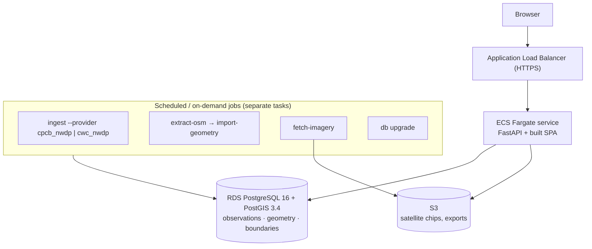

# Production architecture

What a deployed India Water Intelligence looks like, and the rule that shapes
it: **the web application serves data that is already prepared.** It never
ingests, never queries a public map API, and never downloads satellite scenes
while starting up.



## Components

| Piece | Choice | Why |
|---|---|---|
| API + UI | One FastAPI container serving `/api/v1` and the built SPA | One deployable, no CORS, no second origin to secure |
| Database | RDS PostgreSQL 16 with PostGIS 3.4 | The map queries are spatial SQL; SQLite cannot run them and an ephemeral container cannot hold 2.8M observations |
| Object storage | S3 (optional) | Satellite chips and exports; binaries do not belong in the database |
| Jobs | The same image, different command | Ingestion, geometry and imagery run as one-shot tasks, so a web task never blocks on them |
| Migrations | `cli db upgrade`, run once per deploy | Schema changes are explicit and reviewable; `create_all` cannot alter |

Nothing else. No Kubernetes, no queue, no cache server: the data changes a few
times a year, and PostgreSQL plus in-process caching already meets the
latency targets recorded in IMPLEMENTATION_SUMMARY.

## Start-up sequence of a fresh task

1. Container starts, connects to RDS.
2. `report_backend()` logs the backend and **fails fast** if
   `ENVIRONMENT=production` and PostGIS is missing.
3. The API serves. No ingestion, no geometry matching, no scene downloads.

`WATER_BOOTSTRAP_STATES` stays empty in production. It exists for a throwaway
demo container, and loading 35 states takes ~12 minutes — far too long for a
task that must answer a health check in seconds.

## Deploy sequence

```bash
# 1. build and push the image (unchanged from v1)
docker build -f docker/Dockerfile.backend -t <registry>/oceanai-backend:v2 .

# 2. migrate (one-shot task, same image)
aws ecs run-task ... --overrides '{"containerOverrides":[{"name":"backend",
  "command":["python","-m","app.water.cli","db","upgrade"]}]}'

# 3. roll the service
aws ecs update-service --service oceanai-api --force-new-deployment
```

Data jobs are separate scheduled tasks (EventBridge → ECS run-task):

| Job | Command | Cadence |
|---|---|---|
| Water data | `cli ingest --all --provider cpcb_nwdp` then `--provider cwc_nwdp` | Monthly; incremental, so unchanged resources are skipped |
| Geometry | `cli extract-osm --pbf …` then `cli import-geometry --file …` | Quarterly, or after a large ingest |
| Satellite | `cli fetch-imagery --limit N` | Monthly |
| Coverage doc | `cli coverage --markdown docs/DATASET_COVERAGE.md` | After any ingest |

## Sizing

| | Local measurement | Production note |
|---|---|---|
| Observations | 2.8M rows (CPCB 582k + CWC 2.2M) | ~1.5 GB with indexes; db.t4g.small is enough to start |
| Geometry | ~300 water bodies, 771 boundaries | Tens of MB |
| API container | ~300 MB image, <200 MB RSS | 0.5 vCPU / 1 GB task |
| Ingest job | Peaks at one page of rows | 0.5 vCPU / 1 GB, minutes to hours |

## What is not deployed

Nothing in this phase. The public demo still runs v1. Staging brings up the
same stack with `docker compose`; see the smoke sequence in
[INGESTION.md](INGESTION.md#staging-smoke-test).

## Secrets

`DATABASE_URL` (or the RDS credentials behind it) is the only secret the
platform needs; the water sources are public and unauthenticated. It is
supplied as an environment variable from the task definition, sourced from
Secrets Manager. No credential is in the repository, the image, or
`docker-compose.yml`.
