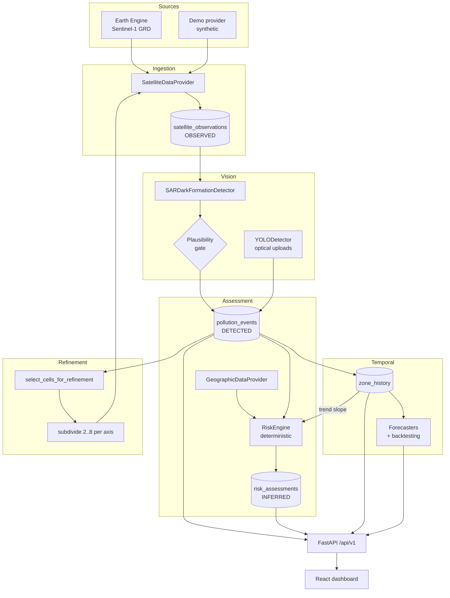
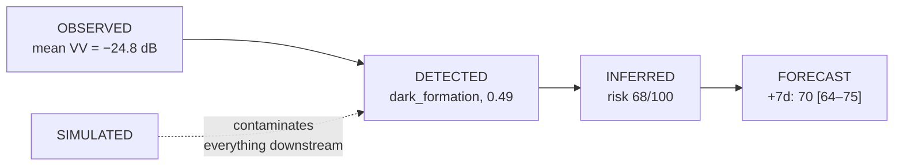
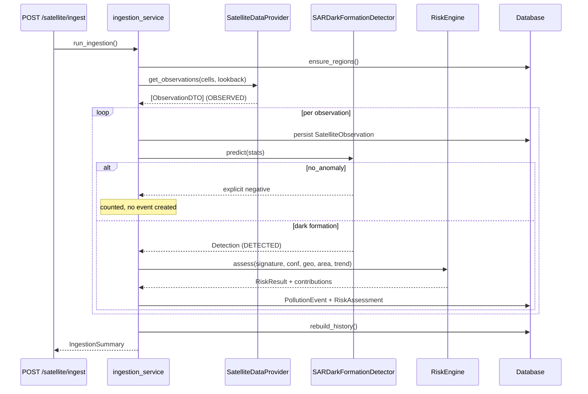
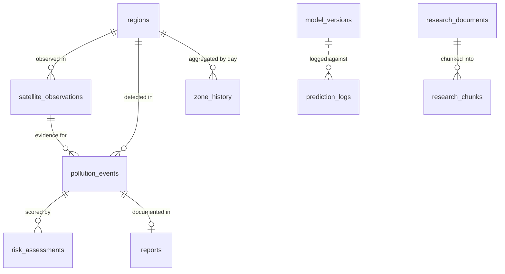

# Architecture

## Design principles

1. **Measurement, detection and inference are distinct.** Separate tables,
   separate types, separate evidence levels. Collapsing them is what let the
   predecessor serve brightness rankings as pollution classifications.
2. **Business logic never lives in a route.** Routes parse, delegate, wrap.
3. **Optional dependencies degrade, they do not crash.** Earth Engine, YOLO
   and LLM providers are all absent by default; the platform starts anyway and
   reports what is unavailable.
4. **Absence is data.** A cell observed and found clean is recorded. A metric
   not measured is `null`. A forecast that cannot be fitted is a refusal.

## Component map



## The evidence ladder

The central abstraction. Every value carries an `EvidenceLevel`, and levels
only ever move *down* the ladder of certainty as data flows:



A simulated measurement can only produce a simulated event, which can only
produce a simulated risk assessment. This is enforced in
`ingestion_service.run_ingestion()` and asserted by `TestProvenanceContract`.

## Ingestion sequence



## Layers

| Layer | Package | Responsibility |
|---|---|---|
| Config / logging / DB | `app.core` | Settings from env, structured logs with request ids and redaction, session factory |
| Domain | `app.models` | ORM tables and the controlled vocabularies (`EvidenceLevel`, `PollutionSignature`) |
| Contracts | `app.schemas` | Pydantic request/response types, provenance envelope |
| Vision | `app.vision` | `BaseDetector` abstraction, SAR / YOLO / mock, registry |
| Satellite | `app.gee` | `SatelliteDataProvider` interface, Earth Engine, demo provider, region grid |
| Risk | `app.risk` | Deterministic engine, geographic context |
| Forecasting | `app.forecasting` | Baseline models with backtesting |
| Services | `app.services` | Orchestration: ingestion, refinement, analytics, forecast, reads |
| Monitoring | `app.monitoring` | Measured latency/volume, PSI drift |
| API | `app.api` | Thin HTTP layer |

## Key abstractions

### `BaseDetector`

```python
class BaseDetector(ABC):
    supported_signatures: frozenset[PollutionSignature]

    @abstractmethod
    def predict(self, payload, **kwargs) -> list[Detection]: ...

    def _validate(self, detections):
        # raises if a detection's signature is outside supported_signatures
```

New detectors register in `app.vision.registry`. The `_validate` guardrail is
what makes "SAR cannot claim plastic" a property of the type system rather
than of reviewer diligence.

### `SatelliteDataProvider`

```python
class SatelliteDataProvider(ABC):
    @property
    @abstractmethod
    def is_available(self) -> bool: ...

    @abstractmethod
    def get_observations(self, cells, lookback_days) -> list[ObservationDTO]: ...

    @abstractmethod
    def get_thumbnail_url(self, bbox, dimensions) -> str | None: ...
```

Keeps `ee` out of routes entirely, lets the platform run credential-free, and
leaves room for Sentinel-2 or a commercial source without touching callers.

### `RiskEngine`

Pure function of its inputs. Returns `RiskResult` with per-factor
`contributions` that sum to `score`, plus `missing_factors`. No I/O beyond the
injected geographic provider, no model calls, no randomness.

## Database schema



`regions` holds both screening cells and refinement sub-cells; sub-cell codes
carry a `__rNcM` suffix and their `extra.refinement_stage` is 2.

## Request lifecycle

1. Middleware binds a request id (honouring an inbound `X-Request-ID`).
2. Route validates via Pydantic, calls a service.
3. Service orchestrates providers, detectors, engines; commits.
4. Route wraps the result, `make_provenance()` scans records for evidence
   levels and simulated flags.
5. Middleware logs method, path, status, duration; echoes `X-Request-ID`.

Unhandled exceptions return a uniform body with no internals leaked.

## Extension points

| To add | Do this |
|---|---|
| A new detector | Subclass `BaseDetector`, declare `supported_signatures`, register in `app.vision.registry` |
| A new satellite source | Implement `SatelliteDataProvider`, select in `app.gee.get_satellite_provider` |
| A new forecasting model | Subclass `BaseForecaster`, add to `forecast_service.MODELS` |
| A new risk factor | Add to `FACTOR_WEIGHTS`, append a `RiskContribution` in `assess()`, bump `ENGINE_VERSION` |
| A real geographic backend | Subclass `GeographicDataProvider`, override the two proximity methods |

## Deferred by design

`app.agents`, `app.rag` and `app.knowledge_graph` exist as empty packages.
They are Phase 2. The foundation they need — an evidence vocabulary, a
deterministic risk engine whose output an LLM can *explain* rather than
invent, and events with real provenance to reason over — is what this phase
built.
