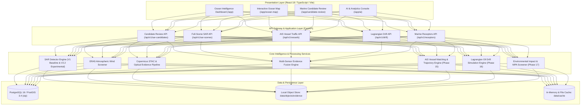

# OceanAI Unified System Architecture
**Project:** OceanAI — India Water Intelligence & Marine Intelligence Platform  
**Document:** `docs/architecture/OCEANAI_SYSTEM_ARCHITECTURE.md`  
**Status:** Living Architecture Specification  
**Version:** 3.0 (Post-Phase 17.0 Baseline)  
**Last Updated:** November 12, 2026  

---

## 1. System Vision & Architecture Overview

OceanAI is an enterprise-grade Water Intelligence and Marine Intelligence Platform designed to monitor, detect, analyze, simulate, and respond to marine pollution incidents across the Indian Exclusive Economic Zone (EEZ) and benchmark marine environments.

The platform follows a layered, decoupled service architecture:

---

## 2. Key Architecture Principles

1. **Functional-First Implementation:** Working functionality across real backend endpoints, real database schemas, and frontend dashboards takes precedence over premature optimization.
2. **Evidence-Based Multi-Sensor Intelligence:**
   - **Sentinel-1 C-band SAR:** Detects surface capillary wave damping and oil-lookalike dark formations.
   - **ECMWF ERA5 Reanalysis:** Provides wind speed and direction context ($3-12\text{ m/s}$ diagnostic window) to identify false positives caused by calm sea surfaces ($<3\text{ m/s}$).
   - **Sentinel-2 MSI Optical:** Provides Bottom-of-Atmosphere (BOA) surface reflectance, true-colour visual confirmation, Scene Classification Layer (SCL) cloud/water masking, and NDCI algal bloom differentiation.
   - **AIS Commercial Fleet Intelligence:** Correlates vessel spatio-temporal trajectories ($D \le 50\text{ km}$, $\Delta t \le 6\text{h}$) to identify potential discharge culprits via Closest Point of Approach (CPA) and Bayesian suspicion scoring.
   - **Lagrangian Numerical Drift Simulation:** Models hydrodynamic advection ($\mathbf{U}_c + 0.03\mathbf{U}_w + \mathbf{U}_{stokes}$), Langevin diffusion, and Fingas evaporative/dispersion weathering to predict shoreline beaching.
   - **Environmental Priority Screener:** Assesses geodesic exposure against Marine Protected Areas (MPAs), coral reefs, mangroves, and municipal desalination intakes to automate tactical response mitigation advice.
3. **Strict Ground-Truth Blindness:** Analyst-facing workflows must never expose original scientific training labels or raw subset designations (`ow`, `oc`, `nw`, `nc`) to prevent confirmation bias during triage.
4. **Independent Provenance Preservation:** Every sensor, model, and reanalysis product preserves its own native metadata, timestamp, error bounds, and limitations.

---

## 3. Technology Stack Reference

| Tier | Component | Technology & Version | Key Libraries |
|---|---|---|---|
| **Frontend** | Single Page Application (SPA) | React 18, TypeScript 5.x, Vite | Lucide Icons, Leaflet, Tailwind CSS, TanStack Query |
| **Backend** | REST API & Async Workers | Python 3.12 / FastAPI 0.119 | Pydantic v2, Uvicorn, httpx, aiohttp |
| **Database** | Relational & Geospatial Store | PostgreSQL 16 + PostGIS 3.4 | SQLAlchemy 2.0, Alembic, psycopg3 |
| **Vision & Geospatial** | Earth Observation Processing | Native Python, PyTorch, Pillow, OpenCV | tifffile, numpy, shapely, torchvision |
| **Containerization** | Local Runtime Infrastructure | Docker Desktop, Docker Compose v2 | Official PostgreSQL/PostGIS alpine images |

---

## 4. Security & Configuration Conventions

- Local environment settings are loaded exclusively from `.env` via `pydantic-settings`.
- Passwords, access tokens, and API secrets are never committed to version control.
- Copernicus Data Space Ecosystem (CDSE) credentials use OpenID Connect (OIDC) token management with automated token refreshes.
- Internal research identifiers are mapped securely within the backend and stripped before serialization to public API consumers.
