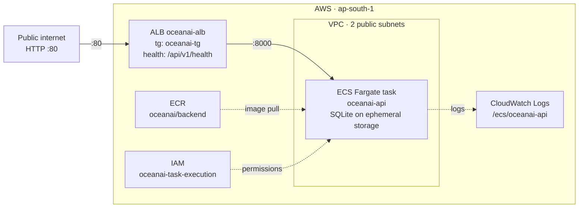

# Deployment

How the platform is packaged, what is actually running in AWS, and what is
deliberately not there.

## Image

A three-stage Docker build (`docker/Dockerfile.backend`):

1. **console** — Node builds the React SPA with Vite, emitting into
   `backend/app/static/app`.
2. **builder** — Python dependencies are installed into a virtual environment.
3. **runtime** — a slim Python base receives the virtualenv and the built
   assets, and runs as a non-root user.

Node never reaches the runtime layer, so the shipped image contains no
JavaScript toolchain. Final size is ~325 MB.

The SPA is served by FastAPI from the same origin as the API. That is a
deployment decision with a security consequence worth stating: because the
frontend calls a relative `/api/v1` path, there is no cross-origin
configuration, no API base URL embedded in the bundle, and nothing for a
misconfigured `CORS_ORIGINS` to expose.

## What is deployed

| Resource | Identifier |
|---|---|
| Region | `ap-south-1` |
| ECR repository | `oceanai/backend` — immutable tags, scan on push |
| ECS cluster | `oceanai-cluster` |
| ECS service | `oceanai-api` — Fargate, desired count 1 |
| Task definition | `oceanai-api:1` — 512 CPU units, 1024 MiB |
| Load balancer | `oceanai-alb` (internet-facing, HTTP :80) |
| Target group | `oceanai-tg` — health check `/api/v1/health` |
| Logs | CloudWatch Logs group `/ecs/oceanai-api` |
| Execution role | `oceanai-task-execution` |



### Network isolation

Two security groups form the boundary:

- **ALB SG** — inbound `:80` from `0.0.0.0/0`.
- **Task SG** — inbound `:8000` **only** from the ALB security group.

The container is therefore not reachable from the internet directly; the only
path to it is through the load balancer.

## The health-check path matters

The target group checks `/api/v1/health`, not `/health`. The API mounts every
route under the `/api/v1` prefix, so a target group pointed at `/health` gets a
404, marks the task unhealthy, and ECS kills and replaces it forever. Verify
the health path against the running routes rather than assuming a convention.

## Persistence: the significant gap

The service uses SQLite on the task's ephemeral filesystem. Consequences:

- A task restart, a redeployment, or a scale event **loses all generated
  detections**.
- Regions and the RAG corpus re-seed automatically at start-up.
- Observations and events do not. Repopulate with:

  ```bash
  curl -X POST http://<alb-dns>/api/v1/satellite/ingest
  ```

  ```bash
  curl -X POST "http://<alb-dns>/api/v1/satellite/refine?max_cells=5"
  ```

Fixing this properly means either RDS PostgreSQL (`DATABASE_URL` already
supports it — no code change) or mounting an EFS volume at the database path.
Neither is implemented.

## Not deployed

Listing absent infrastructure is as useful as listing what exists:

- No S3 bucket, no CloudFront, no WAF, no Route 53 record.
- No RDS instance and no EFS volume.
- No autoscaling policy, no CloudWatch alarms, no dashboards.
- No HTTPS listener and no ACM certificate.
- No authentication or rate limiting on the API.
- **No Terraform or CDK.** Infrastructure was created imperatively with the
  AWS CLI, which means this deployment is not reproducible from source in one
  command. That is the largest engineering gap in the deployment story.

## Enabling HTTPS

Requires a domain you own. Nothing here provisions or purchases one.

1. Request a certificate:

   ```bash
   aws acm request-certificate --domain-name oceanai.YOURDOMAIN \
     --validation-method DNS --region ap-south-1
   ```

2. Add the CNAME that ACM returns to your DNS zone; wait for status `ISSUED`.
3. Create an HTTPS listener on port 443 forwarding to `oceanai-tg`, with the
   certificate attached.
4. Add an inbound `:443` rule to the ALB security group.
5. Change the `:80` listener to redirect to `:443`.
6. Point a CNAME for `oceanai.YOURDOMAIN` at the ALB DNS name.
7. Update `CORS_ORIGINS` in the task definition to the HTTPS origin and deploy
   a new task revision.

## Configuration in the task definition

Environment variables only — no secrets are baked into the image. The deployed
task runs with `DEMO_MODE=true`, `DETECTOR_BACKEND=mock` and
`LLM_PROVIDER=none`, so it needs no credentials at all. Adding a real LLM or
Earth Engine would mean supplying the key through ECS secrets backed by
Secrets Manager or SSM Parameter Store, never as a plaintext environment
variable in the task definition.
