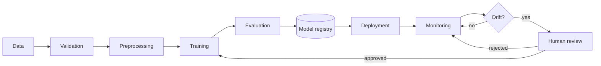

# MLOps

The operating principle: **the pipeline should make it hard to ship a claim
you cannot back up.** Everything below serves that.

## Lifecycle



Note the gate: drift routes to **human review**, never straight to
retraining. See [Retraining policy](#retraining-policy).

## Model registry

The `model_versions` table records name, version, task, framework, dataset
version, training date, artifact URI, status, deployment flag, hyperparameters,
class names — and metrics.

### Null metrics are the feature

```json
{
  "name": "yolo-pollution-detector",
  "version": "yolov8m-best",
  "status": "production",
  "map50": null,
  "precision": null,
  "recall": null,
  "metrics_source": null,
  "notes": "Metrics are null until an evaluation run records them."
}
```

The predecessor's README advertised `mAP50: 0.87, Precision: 0.89, Recall: 0.83`.
No evaluation had produced those numbers. That is the single easiest thing for
an interviewer to falsify — "show me the evaluation run" — and there was no
answer.

Here, metrics are `null` until `ml/evaluation/evaluate_detector.py` writes
them, and `metrics_source` records what produced them.
`test_unevaluated_metrics_are_null_not_invented` enforces it in CI.

### Registering evaluated metrics

```bash
python -m ml.evaluation.evaluate_detector \
    --model-path /path/to/best.pt \
    --dataset /path/to/data.yaml \
    --dataset-version v1 \
    --register
```

Without `--register` it prints the report and writes nothing.

## Prediction logging

Every `/detect` call writes a `prediction_logs` row:

```
request_id · timestamp · model_name · model_version · endpoint
latency_ms · detection_count · max/mean confidence · predicted_classes
input_stats · success · error
```

This is the substrate for both `/metrics` and `/drift`. It records coarse
input statistics rather than the image, so drift monitoring does not require
retaining user uploads.

`/metrics` reports measured p50/p95/max latency, request volume, success rate
and class mix. With no traffic it returns `n: 0` and `null` percentiles — not
zeros, which would read as "instantaneous".

## Drift detection

Population Stability Index over two **non-overlapping** windows: a recent
current window, and the baseline period immediately preceding it. Comparing a
window against a baseline that contains it dilutes any real shift.

```
PSI = Σ (current% − baseline%) · ln(current% / baseline%)
```

| PSI | Verdict |
|---|---|
| < 0.10 | `ok` |
| 0.10 – 0.25 | `warning` |
| > 0.25 | `drift_detected` |

Monitored: mean-confidence distribution (fixed bins over [0,1], so windows are
always comparable) and predicted-class distribution (categorical PSI over the
union of categories).

Empty bins are floored at 1e-6; without that a single unseen category sends
PSI to infinity.

**Below 30 samples per window the check returns `insufficient_data`, not `ok`.**
A verdict from eight samples is noise, and reporting it as "no drift" is worse
than reporting nothing.

## Retraining policy

Drift **flags**; it does not retrain. The `/drift` response says so explicitly:

> `"action": "Flag for human review. This platform does not retrain automatically on drift."`

The reason: drift is a symptom with many causes, and only some warrant
retraining.

| Observed drift | Plausible cause | Right response |
|---|---|---|
| Confidence distribution shifts down | Seasonal sea-state change | Nothing; expected |
| Class mix shifts | Monitoring regions changed | Update baseline |
| Confidence collapses | Upstream preprocessing broke | Fix the bug |
| Sustained shift, inputs verified | Genuine distribution change | Retrain candidate |

Auto-retraining on the first row silently degrades the model by fitting it to
a seasonal artefact. Auto-retraining on the third *bakes a bug into the
weights*. The human gate exists because the cheap failure mode of not
retraining is staleness, and the cheap failure mode of retraining blindly is
an unexplainable model.

Retraining is therefore a deliberate action: review the drift report, verify
the input pipeline, decide, then run training with a new dataset version.

## CI/CD

`.github/workflows/ci.yml` runs six jobs:

| Job | Purpose |
|---|---|
| `lint` | ruff check + format check; mypy advisory |
| `secret-scan` | gitleaks over full history, plus pattern checks for the shapes that leaked before (ngrok tokens, PEM keys, `AIza`/`sk-`) |
| `backend-tests` | Full suite with coverage |
| `contract-checks` | **The scientific-integrity contract** — run as its own job so a failure is unmissable |
| `smoke` | Boots the API, runs ingest → refine → read endpoints against a real server |
| `docker-build` | Builds the image and verifies it serves `/health` |

### The contract job

```yaml
pytest -v \
  tests/test_vision.py::TestHonestyContract \
  tests/test_vision.py::TestSignatureGuardrail \
  tests/test_vision.py::TestPlausibilityGate \
  tests/test_api.py::TestProvenanceContract \
  tests/test_risk.py::TestMissingDataHandling \
  tests/test_forecasting.py::TestInsufficientData \
  tests/test_refinement.py::TestTwoStagePipeline
```

These assert that confidence never claims calibration, SAR cannot emit
optical-only signatures, implausible extents are downgraded, simulated data is
always labelled, missing risk factors never read as safe, thin history refuses
rather than extrapolates, and screening never claims oil while refinement
makes it reachable.

Separating them from the general test job is a deliberate signal: a failure
here is a **correctness regression in the product's core promise**, not a
broken unit test.

## Configuration and secrets

All configuration flows through `Settings` (pydantic-settings), sourced from
environment or `.env`. Nothing is hardcoded.

- `.gitignore` covers `.env`, `*-key.json`, `*service-account*.json`, `*.pem`
- The structured logger redacts credential-shaped keys from every record,
  recursively, including nested dicts
- `.env.example` lists `NGROK_AUTH_TOKEN` under a "not used — do not re-add"
  heading, because that is the token that leaked

## Observability

Structured logs, JSON in production:

```json
{"ts": "2026-08-30T16:21:39+0000", "level": "INFO",
 "logger": "app.services.ingestion_service", "message": "ingestion_complete",
 "request_id": "88383f8c219248d6", "provider": "demo-synthetic",
 "observations_stored": 38, "events_created": 10, "negatives_recorded": 28}
```

A request id is bound per request (honouring inbound `X-Request-ID`), attached
to every record produced while handling it, and echoed on the response — so a
user-reported problem traces to its log lines directly.

## Deployment

`docker/Dockerfile.backend` is multi-stage: build layer with the toolchain,
runtime layer with only the venv. Non-root user, healthcheck, no heavy
optional dependencies (torch, earthengine-api) unless explicitly built in.

`docker-compose.yml` brings up backend plus Postgres. It defines no secret;
`POSTGRES_PASSWORD` is required from `.env` and compose fails loudly without
it.

> **Status:** the Docker artifacts are written but have **not been built or
> run** — the Docker daemon was unavailable in the development environment.
> The `docker-build` CI job will exercise them on first push. Treat as
> untested until it goes green.

## Not yet done

- **Alembic migrations.** `init_db()` creates tables; nothing handles schema
  evolution. Required before any deployment that must preserve data.
- **MLflow.** Experiment tracking is a natural next step; the registry table
  is deliberately shaped to map onto it.
- **Task queue.** Ingestion is synchronous. Stage-2 refinement can issue up to
  64 Earth Engine calls per cell and will exceed request timeouts at scale.
- **Prometheus/Grafana.** `/metrics` returns JSON; a Prometheus exposition
  format endpoint plus dashboards is straightforward from here.
- **Load testing.** The Postgres path is configured but unexercised under
  concurrency.
